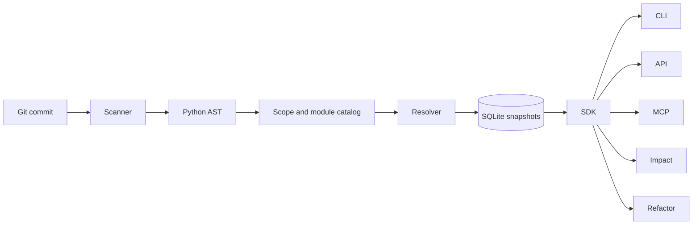

# 架构

ADR 001 以 Git 对象为文件来源。Git 树、内容摘要和持久化版本关联，分析期间没有工作区文件输入。

ADR 002 用 Python AST 构建可序列化语法事实，解析器和解析引擎分别演进。静态不确定性在边上保存，关系模型不包含控制流或数据流。

ADR 003 用 SQLite 事务发布不可变版本，用 NetworkX 实现查询图。存储和计算不依赖接口框架。

ADR 004 重构在内存生成补丁。目标仓库代码的动态验证通过明确请求的 Docker 执行入口。

## 边界与运行配置

原始 Git 文件经解析器产生 Unit，解析目录把 Unit 连接为带置信度的 Edge。持久层以版本键原子提交完整快照。CLI、API 与 MCP 通过 SDK 接入确定性分析。测试沙箱与运行 Web 的容器分开。 [九条调用路径](CALL_FLOW.md)

SQLite 保存事实和关系，NetworkX 构建查询图。LibCST 用解析位置修改 Python 语法。检索融合精确、词法和图证据。计划中的 Tree-sitter、向量索引与数据流留在独立审计清单。 [索引设计](INDEX_DESIGN.md) [能力状态](PROJECT_STATUS.md)
