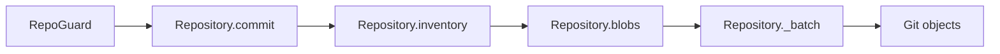
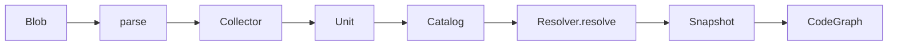
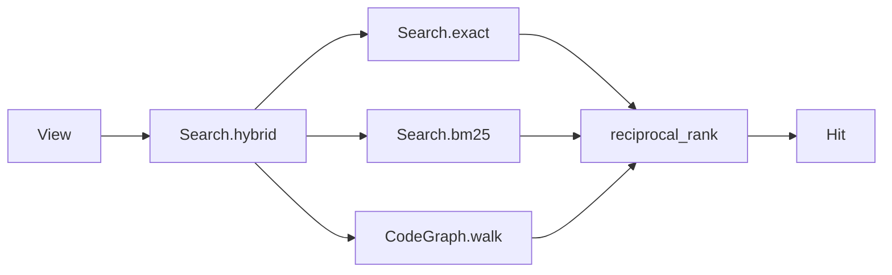
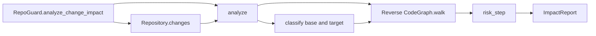
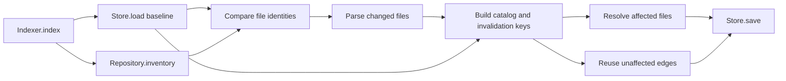
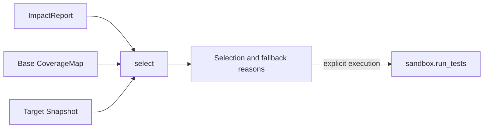
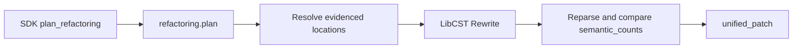
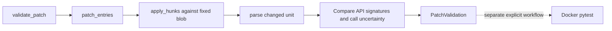

# 实际调用流程

下图表示源码中可追踪的直接调用或数据流。SDK、CLI、HTTP 与 MCP 相互独立，分析复用同一 SDK 和底层模块。

## 仓库读取

## AST、符号表与代码关系图

## 混合检索

## Git 差异与影响

## 增量索引

## 测试选择

## 结构化重构

## Patch 预检与回归

Tree-sitter、向量阶段、PageRank 与通用 Worktree 应用属于待实现范围。SQLite 初始化、提交和查询边界见 [索引设计](INDEX_DESIGN.md)。
