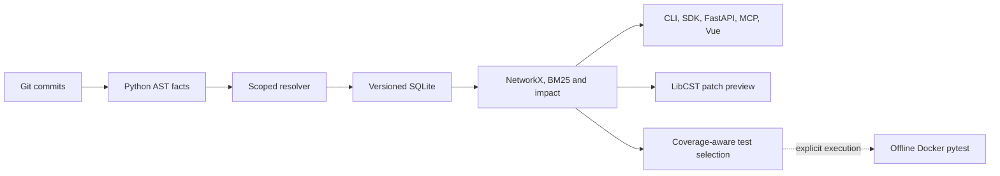

# RepoGuard — Repository-Level Change Impact Analysis & Verified Refactoring Platform

大型代码仓库变更影响分析与验证式自动重构平台。 [English](README.en.md)

面向大型 Python 代码仓库的 Git 版本索引、变更影响分析、测试选择和结构化重构工具。Python SDK、CLI、FastAPI 和 MCP 使用同一套静态分析引擎。验收和剩余工作见 [PROJECT_STATUS.md](PROJECT_STATUS.md)。

## 工作方式

输入是可重复读取的 Git 提交。变更分析在双版本静态图中定位调用或依赖方，提供文件和行号证据。索引复用未变化文件与未失效链接。测试选择给出依据及全量回退；结构化重构先产出补丁供审查。



| 算法 | 当前实现 |
|---|---|
| 符号与依赖 | CPython AST、作用域绑定、跨文件导入、三态置信度。 |
| 图与影响 | NetworkX 多重图、SCC、有界反向 BFS、逐边风险衰减。 |
| 增量 | Git 对象 ID 比较、按探测依赖失效、SQLite 原子发布。 |
| 检索 | 精确符号、BM25、RRF 和图扩展。 |
| 验证 | LibCST 补丁、内存上下文验证、pytest/Coverage.py 与离线 Docker。 |

主要目录为 `src/repoguard`、`tests`、`frontend`、`infra`、`benchmarks`、`artifacts` 与 `docs`。 [完整目录树](PROJECT_TREE.txt) [源码与算法入口](FILE_GUIDE.md)

## 在本地运行

需要 Python 3.11+ 和 Git。服务端可在 Python 3.12 容器运行，前端需要 Node.js 20+。

Windows 的虚拟环境、诊断和 Compose 步骤见 [WINDOWS_QUICKSTART.md](WINDOWS_QUICKSTART.md)。Linux/macOS 可用 `source .venv/bin/activate` 激活，再执行相同的 pip 和 CLI 命令。

```powershell
python -m venv .venv
.\.venv\Scripts\Activate.ps1
python -m pip install -e ".[dev,refactor,architecture,testing,api,mcp]"
git clone --depth 2 --branch 8.1.8 https://github.com/pallets/click.git .benchmark/click-full
repoguard --repo .benchmark/click-full index --base HEAD~1 --target HEAD
repoguard --repo .benchmark/click-full search click.formatting.iter_rows
repoguard --repo .benchmark/click-full callers click.formatting.iter_rows
repoguard --repo .benchmark/click-full graph click.formatting.iter_rows --reverse
repoguard --repo .benchmark/click-full impact HEAD~1 HEAD --format markdown
repoguard --repo .benchmark/click-full select-tests HEAD~1 HEAD
repoguard --repo .benchmark/click-full plan click.formatting.iter_rows aligned_rows
repoguard --repo .benchmark/click-full validate-patch artifacts/click-iter-rows.patch
python -m pytest -q
```

默认索引 Git 提交中的受支持 Python 文件，优先使用 `src` 和仓库根目录作为源码根。全局参数 `--root` 可重复指定。默认 SQLite 位于当前工作目录的 `.repoguard/index.sqlite`，可用 `--db` 选择其他数据库。重构命令输出计划和补丁供审查。

## Docker 测试与可视化

```powershell
docker build -f infra/runner.Dockerfile -t repoguard-runner:0.1 .
repoguard --repo .benchmark/click-full run-tests --image repoguard-runner:0.1
docker compose up --build -d
```

本地查看 [RepoGuard Explorer](http://127.0.0.1:8080)。Compose 使用只读仓库挂载，API 初始化 SQLite 索引。使用 `.env.example` 设置其他路径和提交。测试容器从 Git 对象接收快照，运行时关闭网络。详见 [SECURITY.md](SECURITY.md)。

## SDK 与 MCP

```python
from repoguard.sdk import RepoGuard

engine = RepoGuard(".benchmark/click-full", ".repoguard/index.sqlite")
view = engine.index("HEAD", base="HEAD~1")
symbol = view.find_definition("click.formatting.iter_rows")[0]
callers = view.get_callers(symbol.id)
report = engine.analyze_change_impact("HEAD~1", "HEAD")
```

```powershell
repoguard-mcp --repo .benchmark/click-full --db .repoguard/index.sqlite --revision HEAD
```

MCP 启动时固定一个已发布的提交，通过 stdio 提供结构化查询、差异分析和补丁预检。HTTP OpenAPI 位于 `/docs`。索引发布接口可用 `REPOGUARD_WRITE_TOKEN` 启用。与 SWE-RepairLab 的直接联动处于待实现状态。

## 实证证据与边界

Click 8.1.8 基准实际索引 70 个 Python 文件、17,829 行、5,451 个符号与 33,202 条关系。在原始对照中，发布提交的全量和依赖增量耗时中位数分别为 0.523 秒和 0.719 秒，受控格式化变体分别为 0.872 秒和 0.606 秒。两个对照的索引语义一致。独立全量回归捕获 50 个失败，覆盖策略收集 627/650 个用例并覆盖全部失败。 [实验报告](EXPERIMENT_REPORT.md)

本轮发布前重新运行 pytest、Ruff、类型和安全检查、前端构建与 Click 对照。结果与退出码分别留档。类型检查仍有发现。 [测试报告](TEST_REPORT.md) [续测记录](artifacts/release-checks/)

当前仅支持 Python 静态分析，类型分派、动态注册、子进程覆盖等信息可能不全。SQLite 以整版读写，增量表现随变更和环境而变。Tree-sitter、CFG/Data Flow、向量索引和 PostgreSQL 尚待实现。 [能力状态](PROJECT_STATUS.md)

## 实验与学习

- [Click 实验协议](BENCHMARK_PROTOCOL.md)、[结果](EXPERIMENT_REPORT.md)与[原始数据](artifacts/)。
- [架构](ARCHITECTURE.md)、[研发计划](DEVELOPMENT_PLAN.md)和[后续接手](HANDOFF.md)。
- [28 节源码课程](docs/learning/00_project_overview.md)、[函数行号索引](FUNCTION_REFERENCE.md)、[调用图](CALL_FLOW.md)和[相关工具研究](docs/research/related_work.md)。
- [体积审计](PACKAGE_AUDIT.md)、[安全审计](SECURITY_AUDIT.md)、[第三方许可](THIRD_PARTY_NOTICES)、[ChatGPT 源码交接](CHATGPT_HANDOFF.md)和[GitHub 发布报告](GITHUB_PUBLISH_REPORT.md)。
